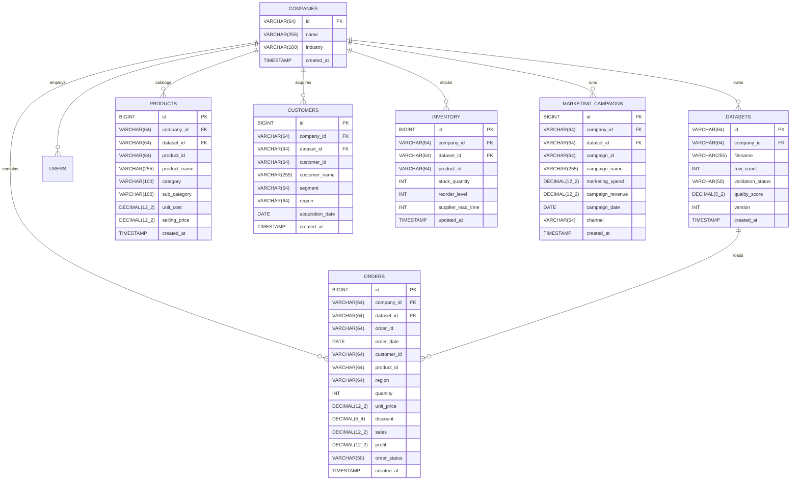

# NEXORA — Database Architecture & Data Modeling Specification
**Document ID: NEX-DATA-2026**

---

## 1. Schema Design Principles

NEXORA employs a normalized relational schema designed for MySQL 8, with full compatibility for in-memory/file-based H2 during local testing and CI/CD pipelines.

Key database design tenets:
1. **Multi-Tenant Isolation**: Every operational table includes a `company_id` foreign key. All queries enforce organization-level scoping.
2. **Immutable Dataset Versioning**: The `datasets` table maintains an audit log of all uploaded files, row counts, validation statuses, and quality scores. Each upload increments a version counter (`version`).
3. **Monetary Precision**: All financial fields (`sales`, `profit`, `unit_price`, `unit_cost`, `marketing_spend`) are defined as `DECIMAL(12, 2)` to eliminate floating-point rounding errors. Discount rates use `DECIMAL(5, 4)`.
4. **Performance Indexing**: Compound indexes are placed on high-frequency filtering columns:
   - `(company_id, order_date)` for time-series range slicing.
   - `(company_id, region)` for geographic drill-downs.
   - `(company_id, product_id)` for SKU-level margin joins.

---

## 2. Entity-Relationship Diagram



---

## 3. Detailed Data Dictionary

### Table: `orders`
Stores individual transaction line items.
- `id` (BIGINT, Primary Key, Auto-increment): Surrogate key.
- `company_id` (VARCHAR(64), Indexed): Organization owning the transaction.
- `dataset_id` (VARCHAR(64)): Identifier of the ingested dataset.
- `order_id` (VARCHAR(64)): Business identifier (e.g. `ORD-10001`). Multiple records can share an `order_id` if an order contained multiple items.
- `order_date` (DATE, Indexed): Date of purchase (YYYY-MM-DD).
- `customer_id` (VARCHAR(64)): Identifier linking to `customers`.
- `product_id` (VARCHAR(64), Indexed): SKU identifier linking to `products`.
- `region` (VARCHAR(64)): Sales territory (`North`, `South`, `East`, `West`, `Central`).
- `quantity` (INT): Number of units purchased ($\ge 1$).
- `unit_price` (DECIMAL(12, 2)): Catalog unit price.
- `discount` (DECIMAL(5, 4)): Applied discount percentage (e.g. `0.1500` for 15%).
- `sales` (DECIMAL(12, 2)): Net sales value = $\text{quantity} \times \text{unit\_price} \times (1 - \text{discount})$.
- `profit` (DECIMAL(12, 2)): Net profit = $\text{sales} - (\text{quantity} \times \text{unit\_cost})$.
- `order_status` (VARCHAR(50)): `Completed`, `Shipped`, `Returned`, or `Cancelled`.

### Table: `inventory`
Tracks stock levels and safety buffer parameters.
- `product_id` (VARCHAR(64)): SKU identifier.
- `stock_quantity` (INT): Units currently in warehouse inventory.
- `reorder_level` (INT): Threshold below which safety stock is compromised.
- `supplier_lead_time` (INT): Transit days required for supplier fulfillment.

---

## 4. Flyway Database Migrations
Migrations reside in:
`database/migrations/V1__init_schema.sql`  
`backend/src/main/resources/db/migration/V1__init_schema.sql`

To deploy against production MySQL:
```bash
mysql -u nexora -p nexora_db < database/migrations/V1__init_schema.sql
```
